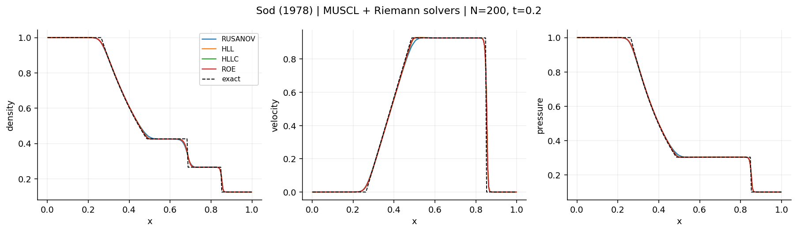
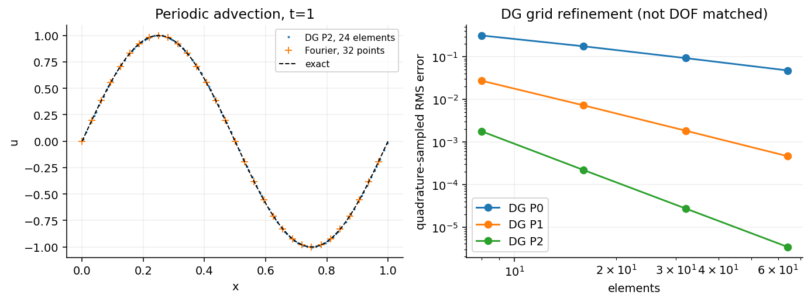
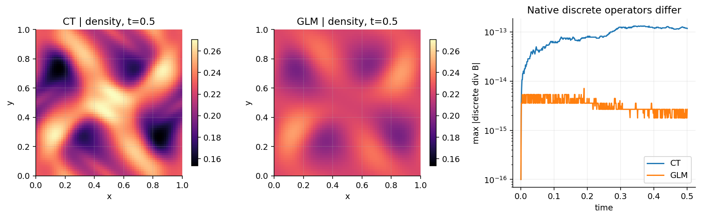

# The Art of Numerical Algorithms

**Read the paper. Understand the method. Run the benchmark.**

数値計算法を、歴史・方程式・実装・検証から読み直すショーケース。
[The Art of Thermal Instability](https://koyamahr.github.io/the-art-of-thermal-instability/#home)
と並ぶ姉妹企画として準備中です。現在はローカルの計算ライブラリと資料であり、公開サイトは未作成です。

## はじめに

```bash
python3 -m venv .venv
source .venv/bin/activate
python -m pip install '.[test]'
python -m pytest -q
python -m numart.cli gallery --output outputs/gallery
```

既存の仮想環境を使う場合は `source .venv/bin/activate` から実行します。
図版、計算データ、設定、ソースの SHA-256 は同じ出力ディレクトリに保存します。
チェックイン前の計算では Git revision は `null` になり、ソースハッシュで版を識別します。

## 読む順序

1. [歴史順のアトラス](docs/history.md)：CFL、拡散・陰解法、Lax、Godunov、マルチグリッド、DG、スペクトル法、Roe、ENO/WENO、MHD、dual time stepping。
2. [差分・CFL・安定性・Lax の定理](docs/stability.md)：前進／後退／風上と、陽／陰の違い。
3. [拡散・楕円型・境界条件・反復法](docs/elliptic.md)：Thomas、Dirichlet／Neumann／Robin、緩和、スペクトル半径、V-cycle。
4. [テスト計算ライブラリ](docs/benchmarks.md)：定義、参照解、境界条件、比較の範囲。
5. [MHD：CT と GLM](docs/mhd.md)：離散的 ∇·B、Orszag–Tang、誤差注入試験。
6. [前処理・dual time・residual distribution](docs/advanced.md)：実装した最小モデルと多次元への拡張。
7. [NASA の 2D ケース集](docs/nasa-2d.md)：公式の検証資料への導線。これらの流体計算は未実装。
8. [論文と書籍](docs/references.md)、[BibTeX](references.bib)、[実装・公開ロードマップ](docs/roadmap.md)。

## 実行例

```bash
python -m numart.cli run sod --method muscl --riemann roe --n 200
python -m numart.cli run lax --method muscl --riemann hllc --n 200
python -m numart.cli run shu-osher --method weno5 --n 400
python -m numart.cli run entropy-wave --method weno5 --n 160
python -m numart.cli run double-rarefaction --method godunov --riemann hlle --n 200
python -m numart.cli run dam-break --riemann hll --n 200
python -m numart.cli run isothermal --riemann hll --n 200
python -m numart.cli run orszag-tang --method ct --n 64 --output outputs/ct
python -m numart.cli run orszag-tang --method glm --n 64 --output outputs/glm
```

`run` は数値データと `run.json` を書きます。比較図は `gallery` で生成します。
同じ出力先は上書きされるので、保存したい比較には別々の `--output` を指定してください。
WENO の `--riemann` は使用されません。WENO は大域的 Lax–Friedrichs 流束分離です。

Python からも、例えば次のように使えます。

```python
from numart import get_problem, solve
from numart.advection import dg_advection, dual_time_advection
from numart.linear import diffusion_1d, poisson_1d, poisson_2d, Boundary, poisson_boundary_1d
from numart.multigrid import solve_poisson_multigrid
import numpy as np

r = solve(get_problem("sod"), n=200, method="muscl", riemann="hllc")
x, u, modes = dg_advection(n=32, degree=2)
x, u, settings = diffusion_1d(method="crank-nicolson", dt=0.001)
x, u = poisson_boundary_1d(63, -2., Boundary.dirichlet(1.), Boundary.neumann(2.))
u, residual = solve_poisson_multigrid(np.ones((63, 63)))
```

## 初版の計算例







これらは独立した教育用実装の図です。原論文の図そのものの再現とは区別しています。
CT と GLM の図は異なる離散演算子・散逸を使っており、∇·B の数値だけで優劣を判断できません。

## 初版で実装した範囲

- 空間差分：前進・後退・中心・風上、Lax–Friedrichs、Lax–Wendroff、成分別 FD WENO5-JS。
- 有限体積：区分一定 Godunov 型、primitive minmod MUSCL。Rusanov／HLL／HLLE／HLLC／Roe。
- DG：周期線形移流の modal Legendre P0/P1/P2、upwind flux、SSPRK3。
- スペクトル：周期線形移流・拡散の Fourier 法とモードの厳密時間積分、Fourier 微分。
- MHD：2D planar、1次 Rusanov、staggered CT とセル中心 GLM。
- 拡散・楕円型：FTCS／後退 Euler／Crank–Nicolson、1D Thomas、2D matrix-free CG。
- 反復法：Jacobi／GS／SOR の反復行列、red-black GS／SOR、幾何学的 multigrid V-cycle。
- 最小モデル：BDF1/BDF2 dual time stepping、Jacobi スケーリングと条件数、1D scalar residual distribution。

多次元 Euler の rotated-hybrid Riemann solver、低 Mach PDE 前処理、2D residual distribution、Euler/MHD DG は資料・計画の段階です。
NASA の翼型・境界層・剥離ケースには別途 Navier–Stokes/RANS と格子・壁面処理が必要です。

## 検証と公開

`tests/` は流束整合性、厳密解、収束次数、周期保存、正値性の選定試験、CT の離散発散保存、GLM の誤差注入、線形系残差、境界条件、multigrid を確認します。
汎用的な正値性や非線形安定性を証明するものではありません。
GitHub Actions 用のワークフローは用意していますが、リモート CI はまだ実行していません。

将来のサイトは「年代順の文献 → 解説 → 実行 → 比較図 → 検証記録」を単位にします。
公開先・外観・ライセンスは資料を整えた後に相談します。
