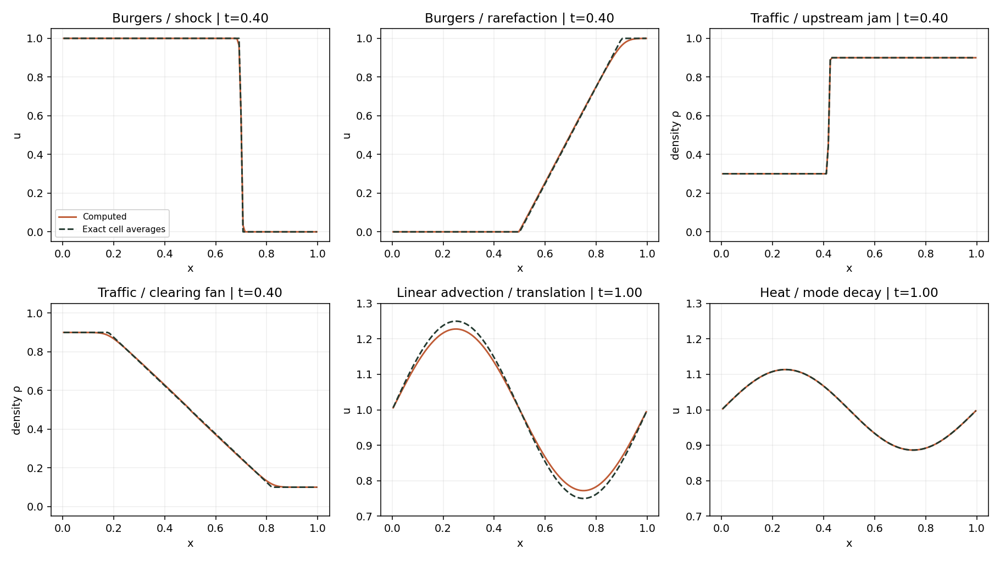

# Equation gallery: choose the equation before the algorithm

The local Web edition provides an **Equations** gallery with saved profiles,
physical-time controls, fixed plot ranges, initial/boundary conditions,
characteristic speeds and links back to methods and papers. It contains nine
cases across seven equation families. Data are generated by
`python scripts/build_equation_gallery.py`, not invented animation curves.

## Translation and diffusion

Linear advection u_t+u_x=0 moves a periodic sine wave. First-order upwind with
forward Euler is compared with exact translated cell averages. Heat diffusion
u_t=0.02u_xx damps the same Fourier mode; centered spatial differences and
forward Euler use νΔt/Δx²≤0.4. Their discrete means are conserved.

## Burgers: shocks and fans

[Burgers (1948)](https://doi.org/10.1016/S0065-2156(08)70100-5) is the classical
model reference; this exhibit uses its **inviscid scalar conservation law**:

\[
u_t+(u^2/2)_x=0,\qquad f'(u)=u.
\]

A decreasing jump forms a shock traveling at (u_L+u_R)/2. An increasing jump
forms a rarefaction fan, with u=x/t in coordinates centered on the initial
jump. Exact Godunov flux selects the entropy solution, including zero flux
inside a transonic Burgers fan. The plotted exact curves are cell integrals,
so a shock cutting a cell is not treated as a point sample.

## Traffic: a jam can move against the cars

[Lighthill–Whitham (1955)](https://doi.org/10.1098/rspa.1955.0089) and
[Richards (1956)](https://doi.org/10.1287/opre.4.1.42) are the independent
classical traffic references. This exhibit chooses a normalized quadratic
fundamental diagram, rather than asserting that every traffic model has it:

\[
\rho_t+[\rho(1-\rho)]_x=0,\qquad 0\leq\rho\leq1.
\]

Vehicles move at 1−ρ, while small density disturbances move at 1−2ρ.
A jump from 0.3 to 0.9 shocks at speed −0.2, despite positive vehicle speeds.
The opposite ordering creates a clearing fan because the flux is concave.
Both Burgers and traffic use MUSCL minmod, Godunov flux, SSPRK3 and CFL≤0.4.
Density bounds are checked; the solver does not silently clip them.

## Fluid systems and kinetic methods

The existing Euler Sod, wet shallow-water dam-break and isothermal density-jump
solvers are connected as additional cases. Sod overlays a point-sampled exact
Euler reference; its sample L1 diagnostic is not an integrated FV error.
Shallow-water and isothermal curves currently have **no exact overlay**.
Those models and positive-depth limits are defined in [the benchmark guide](benchmarks.md).

[LBM](lattice-boltzmann.md), [Chapman–Enskog expansion](chapman-enskog.md),
[periodic incompressible flow](incompressible.md), and
[hyperbolic diffusion](hyperbolic-diffusion.md) have separate computed exhibits.
An equation, a kinetic model and a discretization are different choices.

## Saved times and reproducibility

Scalar snapshots observe completed solver steps: their actual times can differ
slightly from the requested display times. Output requests leave the trajectory
unchanged. The existing 1D system baseline has no snapshot API; its displayed
fluid times are explicitly labeled **independent solves**, each ending at the
shown time. Playback links those runs and does not imply identical intermediate
steps. Outflow mean changes include boundary flux and are not labeled mass loss.

[Download profiles and source hashes](figures/equation-gallery.json).
[Additional convergence evidence](figures/solver-foundations.json) keeps these
new experiments separate from the atlas's original validation manifest.

## Additional equation maps

The [biological survey](biological-models.md) catalogs 22 model families with
original references and proposed verification, without adding biological
simulations. The [Arakawa grid chapter](geophysical-grids.md) adds computed
A/B/C Fourier-symbol comparisons for linear rotating shallow water, rather
than another fluid movie. These statuses remain distinct from the nine
precomputed cases above.
