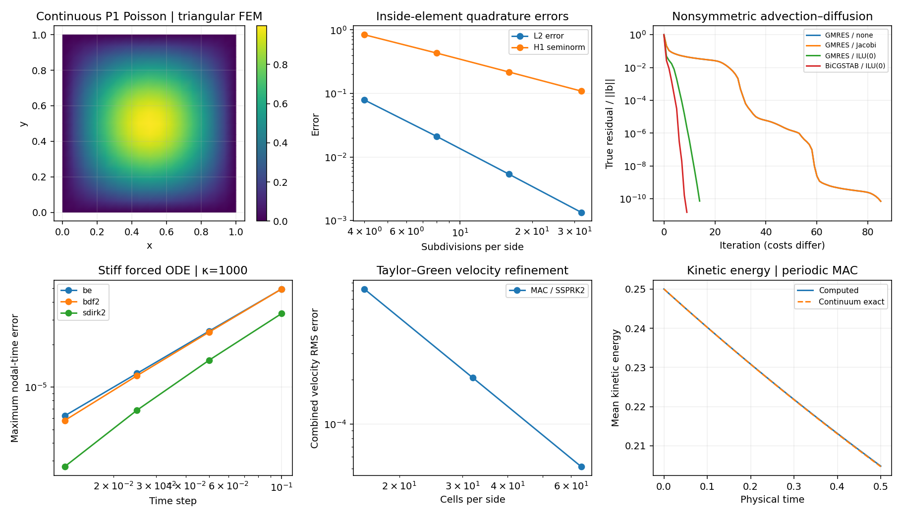

# Continuous finite elements: from weak form to sparse assembly

**Implemented:** continuous P1 elements on intervals and affine triangles,
Poisson with Dirichlet data, consistent mass matrices, and quadrature error norms.
This is distinct from the atlas's discontinuous Galerkin advection example.

The [basis-function chapter and notebook](basis-functions.md) connect these nodal shapes to Legendre modes, GLL nodes, exact and quadrature mass matrices, and triangular P2 functions. The assembler in this FEM chapter remains P1.

## 1943: a variational route

[Courant (1943)](https://doi.org/10.1090/S0002-9904-1943-07818-4)
is a foundational variational reference. This chapter's small implementation
is an independent modern P1 demonstration, rather than a reproduction of his examples.

For −Δu=f, prescribe u=g on the boundary. Multiplication by a test function
that vanishes there and integration by parts give

\[
\int_\Omega \nabla u_h\cdot\nabla v_h\,d\Omega
=\int_\Omega f v_h\,d\Omega.
\]

Write u_h as nodal coefficients times continuous piecewise linear basis
functions. On a triangle K, the shape gradients are constant:

\[
K^K_{ij}=|K|\nabla\phi_i\cdot\nabla\phi_j,
\qquad M^K_{ij}=\frac{|K|}{12}(1+\delta_{ij}).
\]

Shared nodes accumulate element contributions into CSR storage. Nonzero
Dirichlet values move to the right-hand side before symmetric row/column
elimination. Treating only rows would destroy the symmetry relevant to CG.
The example uses [ILU-preconditioned GMRES](sparse-nonlinear.md).

## Inspect the evidence



The manufactured solution is sin(πx)sin(πy) on the unit square. L2 and H1
seminorm errors are integrated **inside elements**, not measured only at nodes.
The expected smooth-solution orders are two and one. Tests also cover affine
patches, nonzero boundary data, constant null vectors before boundary
elimination, and total consistent mass.

```python
from numart.fem import poisson_2d
result = poisson_2d(16)
print(result.residual, result.u.shape)
```

Reproduce with `python scripts/build_equation_gallery.py`. The dedicated
[manifest](figures/solver-foundations.json) records errors and source hashes.
Mixed velocity–pressure elements, inf–sup conditions, curved meshes, general
Neumann/Robin assembly and adaptive refinement remain future work. The current
[projection example](incompressible.md) uses a staggered finite-difference grid.

For definitions and comparisons of **A-stability, L-stability and L1/L2/L∞ error norms**,
see the [shared accuracy and stability guide](accuracy-stability.md).
