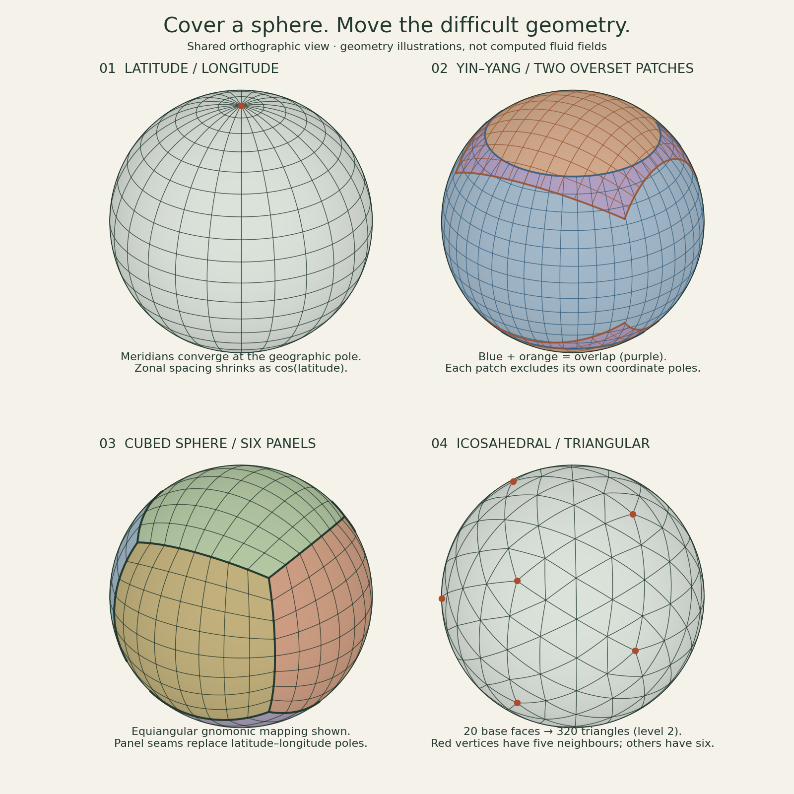
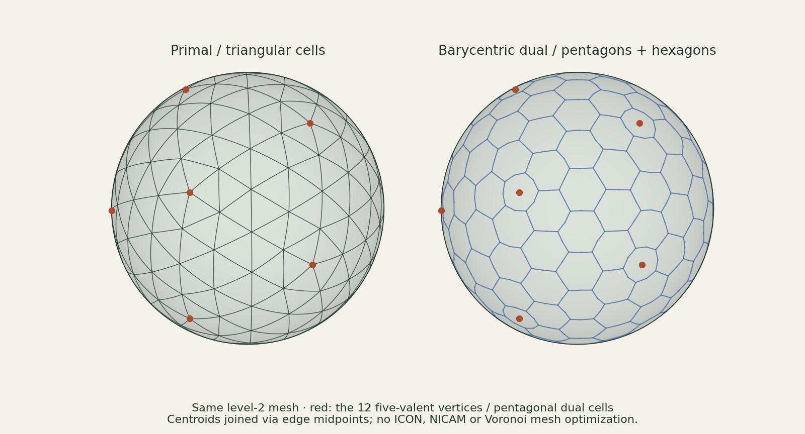
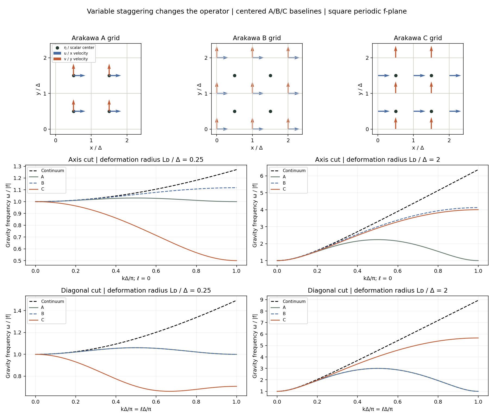

# Spherical meshes and Arakawa A, B and C grids

A/B/C names specify **where different variables live on a mesh**. They are
not an accuracy order, a mesh shape, or a time-stepping family. A structured
rectangular mesh may use any of these staggerings. The conventional comparison
is described by [Arakawa–Lamb (1977)](https://doi.org/10.1016/B978-0-12-460817-7.50009-4),
with a useful agency exposition in the
[ECMWF numerical-methods notes](https://www.ecmwf.int/sites/default/files/elibrary/2002/16948-numerical-methods.pdf).

**Implemented here:** spherical mesh geometry diagrams, plus placement diagrams
and tested Fourier symbols for a linear periodic f-plane shallow-water system. This is not an A/B/C nonlinear
weather or ocean model, and it introduces no new full flow simulation.

## A sphere needs several charts {#spherical-meshes}

Mesh geometry and variable staggering are separate choices. A cubed sphere
can carry a C-grid arrangement; a triangular mesh can also store edge-normal
velocities. A/B/C labels alone do not specify spherical connectivity or metrics.

On a sphere of radius R, with latitude φ and longitude λ,

\[
 ds^2=R^2\left(d\varphi^2+\cos^2\varphi\,d\lambda^2\right),
 \qquad \Delta s_\lambda\simeq R\cos\varphi\,\Delta\lambda.
\]

Geographic poles are regular physical locations. Longitude becomes undefined
there, while equal longitude increments become very short near them. An
explicit wave/advection CFL bound can therefore become restrictive. Pole
filters, reduced grids and spectral methods are other responses; replacing
the mesh is not the only option. The three constructions below avoid the
single latitude–longitude chart's polar convergence, while introducing other
coupling and metric questions. None is automatically equal-area.

## Yin–Yang: two overlapping low-latitude patches {#yin-yang}

[Kageyama–Sato (2004)](https://arxiv.org/abs/physics/0403123) combine two
identical latitude–longitude patches. In each patch's own coordinates,

\[
 |\varphi|\leq\pi/4+\delta,\qquad |\lambda|\leq3\pi/4+\delta,
 \qquad
 \boldsymbol{x}^{\mathrm{Yang}}=
 \begin{pmatrix}-1&0&0\\0&0&1\\0&1&0\end{pmatrix}
 \boldsymbol{x}^{\mathrm{Yin}}.
\]

The rotation puts each chart's poles inside the other chart's low-latitude
region. The figure uses δ=3°; purple marks overlap, not a third patch.
Each component retains orthogonal latitude–longitude coordinates and familiar
metrics. Boundary data must be transferred through the overlap. Interpolating
scalar values alone does not guarantee a globally conservative mass budget;
overlap ownership/weights and conservative coupling need explicit design.
Velocity components must also rotate between local tangent bases. These
transfers are explained here, but no overset transport solver is implemented.

## Cubed sphere: six connected panels {#cubed-sphere}

The six-face construction is associated with
[Ronchi–Iacono–Paolucci (1996)](https://doi.org/10.1006/jcph.1996.0047).
Our diagram chooses **equiangular gnomonic** coordinates. For an orthonormal
face frame with outward normal n and tangent directions e₁,e₂,

\[
 \boldsymbol{x}(\xi,\eta)=R\,
 \frac{\boldsymbol{n}+\tan\xi\,\boldsymbol{e}_1+\tan\eta\,\boldsymbol{e}_2}
 {\left\lVert\boldsymbol{n}+\tan\xi\,\boldsymbol{e}_1+\tan\eta\,\boldsymbol{e}_2\right\rVert},
 \qquad -\pi/4\leq\xi,\eta\leq\pi/4.
\]

The picture has 8×8 cells per panel. Adjacent panel boundaries match; three
panels meet at each cube corner. This mapping avoids a latitude–longitude
pole but is generally nonorthogonal inside a face, and cell areas and metric
factors vary. Other cubed-sphere projections have different properties.
Neighbor indices, vector components and numerical fluxes must agree across
seams. A continuous-looking diagram is not a test of those operators.

## Icosahedral triangles and their dual {#icosahedral}

Start with 20 triangular faces, split each triangle into four using edge
midpoints, and project new vertices radially onto the sphere. At level L,

\[
 F=20\,4^L,\qquad E=30\,4^L,\qquad V=10\,4^L+2,
 \qquad V-E+F=2.
\]

Level 2 has 320 triangles, 480 edges and 162 vertices. Twelve vertices have
five neighbors; the others have six. Connecting neighboring face centers through shared edge midpoints
produces a dual with twelve pentagons and otherwise hexagons. Here the centers
are **normalized triangle centroids**: this is a barycentric dual, not a claim
of a Voronoi/Delaunay orthogonal pair. For this unoptimized sample, the largest
triangle area is about 1.275 times the smallest, so quasi-uniform does not mean
equal-area. The connectivity formulas apply to this regular refinement, not
every possible spherical unstructured mesh.

The [ICON model description](https://gmd.copernicus.org/articles/6/735/2013/gmd-6-735-2013.html)
is a useful example of triangular mesh geometry combined with C-type
staggering. Our illustration is not the optimized ICON mesh or its dynamical
core. Accurate divergence, gradient, vorticity and wave dispersion still
depend on compatible discrete operators.

## Interfaces, vectors and what the figures verify {#spherical-interface-checks}

A physical tangent velocity is one vector, even when its components differ
between charts. If E_A and E_B have orthonormal tangent basis vectors as
columns in one common Cartesian frame, then

\[
 \boldsymbol{v}=E_A\boldsymbol{u}_A=E_B\boldsymbol{u}_B,
 \qquad \boldsymbol{u}_B=E_B^{\mathsf T}E_A\boldsymbol{u}_A.
\]

This formula uses orthonormal physical components. Covariant or contravariant
components in nonorthogonal coordinates require the corresponding metric and
dual basis. Copying two component arrays across a seam is insufficient.
For finite volumes, a shared interface needs the same integrated flux with
opposite signs in neighboring cell budgets. Overset grids additionally need
a well-defined accounting of overlap; summing both full patches counts some
area twice.

The geometry tests check unit radii, matching cube-panel boundary nodes,
icosahedral edge incidence and valence, Euler's identity, and total spherical
triangle area 4π. A deterministic equal-area sample checks Yin–Yang coverage
and overlap; this sampled check is not a formal coverage proof. Reproduce both
figures with `python scripts/build_spherical_meshes.py`; the
[geometry manifest](figures/spherical-meshes.json) records construction choices,
area statistics and source/artifact hashes. These checks do not establish
transport accuracy, seam conservation or geophysical wave convergence. Useful
next tests would rotate a smooth tracer across every seam and monitor global
mass, then compare balanced shallow-water waves under refinement.

## A, B and C specify relative placement

Take free-surface perturbation η at scalar cell centers (i+1/2,j+1/2), with
square cell size Δ. Define u as the x velocity and v as the y velocity.

- **A grid:** η, u and v are all at the same center.
- **B grid:** η is at the center; both u and v are at vertices (i,j).
- **C grid:** η is at the center; u is at x-normal faces (i,j+1/2), and v is
  at y-normal faces (i+1/2,j).

Choosing vertices rather than centers as the origin reverses some diagram
conventions without changing the relative placement. Plot the locations and
component directions before comparing array indices between models.

On a C grid, normal face velocities naturally supply cell divergence, and
center-to-center scalar differences give face pressure gradients. That is the
placement already used by the atlas's [periodic MAC projection](incompressible.md).
The relationship concerns spatial location; MAC and an ocean C-grid dynamical
core need not share their Coriolis, advection, boundary or time algorithms.
The official [MITgcm staggering description](https://mitgcm.readthedocs.io/en/latest/algorithm/c-grid.html)
shows this face-normal arrangement in three dimensions.

## Rotation and gravity waves make the difference visible

For constant mean depth H and constant Coriolis parameter f,

\[
u_t-fv=-g\eta_x,\qquad v_t+fu=-g\eta_y,
\qquad\eta_t+H(u_x+v_y)=0.
\]

The continuum has a zero-frequency geostrophic branch and gravity branches

\[
\omega^2=f^2+c^2(k^2+\ell^2),\qquad c=\sqrt{gH},\qquad L_D=c/|f|.
\]

A discrete dispersion relation depends on the operators **and** the locations.
Here each grid uses centered second-order pressure/divergence; C-grid Coriolis
uses the symmetric four-point interpolation between u and v locations.
With the physical staggering phases removed, the effective wavenumbers are

\[
\begin{aligned}
A:\quad &\widetilde k=\sin(k\Delta)/\Delta,
&\widetilde\ell=\sin(\ell\Delta)/\Delta,&\quad f_h=f,\\
B:\quad &\widetilde k=2\sin(k\Delta/2)\cos(\ell\Delta/2)/\Delta,
&\widetilde\ell=2\cos(k\Delta/2)\sin(\ell\Delta/2)/\Delta,&\quad f_h=f,\\
C:\quad &\widetilde k=2\sin(k\Delta/2)/\Delta,
&\widetilde\ell=2\sin(\ell\Delta/2)/\Delta,&\quad f_h=f\cos(k\Delta/2)\cos(\ell\Delta/2).
\end{aligned}
\]

The computed baseline has ω_h²=f_h²+c²(k̃²+ℓ̃²). For the energy-scaled state
(u,v,cη/H), the full 3×3 Fourier generator is skew-Hermitian: its eigenvalues
are 0 and ±iω_h. This is a **semi-discrete** result. A time integrator can add
phase error, damping or instability even when the spatial generator conserves
this linear energy.

## Checkerboards and an unresolved deformation radius

A centered A-grid pressure gradient cannot see the shortest alternating
height mode in a coordinate direction. The B-grid baseline removes that
axis-only null mode but retains a diagonal height checkerboard. The C-grid
pressure-gradient/divergence pair couples that mode; however, its simple
Coriolis average vanishes at certain shortest waves. These are distinct
operator effects, not one universal checkerboard diagnosis.

The figure compares both axial and diagonal waves at L_D/Δ=0.25 and 2.
A and B overlap on the diagonal for these square-grid operators, while their
axial curves differ. When the deformation radius is unresolved, Coriolis
averaging can strongly distort the C-grid near-inertial branches. Thus
“C is always best” is not a valid conclusion. Resolved gravity waves,
coarse-grid geostrophic adjustment and directional errors are different tests.
Different Coriolis discretizations can change the comparison without changing
the C placement itself.

## D and E, vertical staggering and magnetic grids

The **D grid** interchanges the face locations of u and v relative to C:
u lies at the y-normal face location and v at the x-normal face location.
The arrows still denote physical x and y components, so a D diagram is not
obtained by merely renaming the C velocity arrays. The **E grid** is commonly
viewed as a B arrangement rotated by 45 degrees; its indexing and resolvable
wavevector set must be treated consistently. They are described here but
have no implemented symbols in this addition.

Horizontal Arakawa staggering is separate from **Lorenz versus
Charney–Phillips vertical staggering**. Likewise, [MHD constrained transport](mhd.md)
uses face/edge placement to enforce a magnetic-divergence identity; it is not
synonymous with an Arakawa C-grid shallow-water algorithm. Each needs its own
compatible discrete operators.

## Evidence and the next geophysical benchmarks

`numart.geophysical_grids` supplies the A/B/C symbols. Tests compare them with
independently applied physical-grid finite-difference stencils on Fourier
waves, check skew-Hermitian energy structure and the geostrophic zero branch,
verify long-wave second-order convergence, and expose the distinct short-wave
null modes. Reproduce the figure with `python scripts/build_geophysical_grids.py`;
the [manifest](figures/geophysical-grids.json) records assumptions, sampled
frequencies and source hashes.

A sensible next flow sequence is geostrophic adjustment, inertia–gravity
waves, a coastal Kelvin wave, and a beta-plane Rossby wave, followed by
potential-vorticity and nonlinear energy/enstrophy budgets. The present
constant-f symbols do not verify beta-plane Rossby propagation, coastlines,
spherical metrics, topography or wetting/drying. A nonlinear Arakawa Jacobian
or energy/enstrophy-conserving shallow-water flux is another algorithmic
choice; selecting A, B or C placement alone does not provide those invariants.
