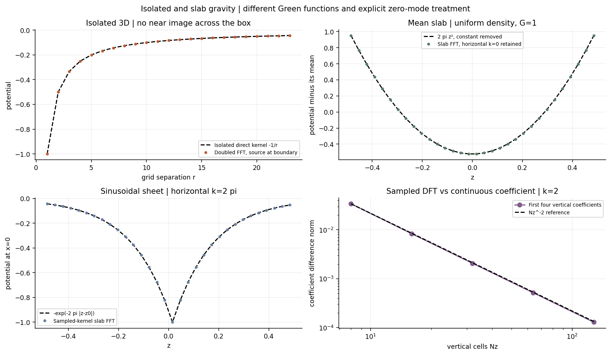

# Gravity kernels: isolated FFTs and a periodic slab

The boundary condition is part of a Poisson solver’s definition. A finite isolated mass, a fully periodic density contrast, and a horizontally periodic disk with vacuum above and below have different Green functions. Padding an array does not by itself choose the right one.

The isolated construction here follows the Hockney–Eastwood doubled-domain convolution idea in [Computer Simulation Using Particles](https://doi.org/10.1201/9780367806934). The disk reference is [Koyama and Ostriker (2009), ApJ 693, 1316–1345](https://doi.org/10.1088/0004-637X/693/2/1316), §2.3 and Appendix A ([author preprint](https://arxiv.org/abs/0812.1846)). It uses horizontal periodicity, vertical domain doubling, and mode-dependent image corrections. Below we derive and test kernels with our own explicit transform normalization; the finite sampled DFT and the continuum Fourier coefficient are distinguished.



## Isolated gravity: linear convolution on a doubled grid

With G = 1, the three-dimensional isolated potential is

\[
\phi(\boldsymbol x)=-\int\frac{\rho(\boldsymbol x')}{|\boldsymbol x-\boldsymbol x'|}\,d^3x'.
\]

For a source grid Nx × Ny × Nz, pad the density with zeros to 2Nx × 2Ny × 2Nz. Build a kernel using signed grid lags on that doubled domain, multiply its FFT by the padded density FFT, invert, and retain the original physical block:

\[
\phi_{\rm physical}=\Delta V\,
\mathcal R\,\operatorname{IFFT}\bigl[
\operatorname{FFT}(\rho_{\rm padded})\operatorname{FFT}(K_{\rm doubled})\bigr].
\]

Source–target separations inside the retained block are less than the original domain length in each direction. The doubled cyclic convolution therefore equals the desired nonperiodic discrete convolution. This is stronger than merely moving periodic images farther away. Replacing K by the usual periodic symbol −4 pi/k² would solve a different problem.

The singular grid-origin kernel must be declared. `isolated_potential` assigns an explicit `self_kernel`, default zero, and uses −1/r elsewhere. It does not integrate the kernel over a finite source cell. Its roundoff-level agreement with a direct grid sum verifies convolution and padding, not high-order continuum accuracy or a uniquely correct self-cell prescription. A fully isolated finite mass can have phi tending to zero at infinity; a slab with nonzero surface density generally cannot.

## Horizontal Fourier transform of a slab

Take x and y periodic and let the density vanish outside a vertical interval of length Lz. With horizontal wavevector k_perp, use the convention

\[
\widehat\rho_{\boldsymbol k}(z)=\frac1{L_xL_y}
\int\rho(x,y,z)e^{-i(k_xx+k_yy)}\,dx\,dy,\qquad
k=\sqrt{k_x^2+k_y^2}.
\]

Poisson’s equation becomes (partial_z²−k²) phi_hat = 4 pi G rho_hat. The full gravitational kernel, including 4 pi G, is

\[
\mathcal G_k(s)=\begin{cases}
-\dfrac{2\pi G}{k}e^{-k|s|},&k>0,\\
2\pi G|s|,&k=0,
\end{cases}\qquad
\widehat\phi_{\boldsymbol k}(z)=\int\mathcal G_k(z-z')\widehat\rho_{\boldsymbol k}(z')\,dz'.
\]

Our sign convention includes the gravitational prefactor in the kernel; some references factor it out. The derivative jump at s = 0 gives 4 pi G, which checks both sign and normalization. Nonzero horizontal modes decay into the exterior. The zero mode is the horizontally averaged mass sheet, with a finite exterior force rather than a decaying potential.

## The vertical Fourier coefficient and the image factor

Only separations |s| < Lz are required. Extend the kernel periodically over a separation interval of length 2Lz and set k_z,ell = pi ell/Lz. For k > 0 the continuous integral is

\[
\widetilde{\mathcal G}_{k,\ell}
=\int_{-L_z}^{L_z}\mathcal G_k(s)e^{-ik_{z,\ell}s}\,ds
=-\frac{4\pi G}{k^2+k_{z,\ell}^2}
\left[1-(-1)^\ell e^{-kL_z}\right].
\]

It follows by integrating the even exponential against a cosine. The square-bracket factor distinguishes the slab kernel from the ordinary fully periodic Poisson multiplier. Equivalently, doubling z and adding a negative image density at displacement Lz with horizontal-mode factor exp(−k Lz) produces this factor before applying the ordinary nonzero Poisson multiplier.

For the k = 0 horizontal mode, the continuous coefficient is

\[
\widetilde{\mathcal G}_{0,\ell}=
\begin{cases}
2\pi G L_z^2,&\ell=0,\\
\dfrac{4\pi G[(-1)^\ell-1]}{k_{z,\ell}^2},&\ell\ne0.
\end{cases}
\]

The all-zero coefficient fixes an additive potential constant in this convention. Other constant gauges give the same force. Dropping the **entire horizontal k = 0 mode**, however, removes the physical mean sheet and is incorrect. Our slab solver does not subtract the mean density.

## A sampled DFT is a different numerical object

Let dz = Lz/Nz and s_j be the 2Nz signed vertical lags. The multiplier for the discrete quadrature is

\[
\widetilde{\mathcal G}^{\rm sampled}_{k,\ell}
=\Delta z\sum_{j=0}^{2N_z-1}\mathcal G_k(s_j)
 e^{-2\pi i j\ell/(2N_z)}.
\]

This is exactly dz times the DFT of the sampled kernel. It is not, at finite Nz, identical to the continuous integral above. For k > 0 its real value can also be evaluated by the geometric series

\[
\widetilde{\mathcal G}^{\rm sampled}_{k,\ell}
=-\frac{2\pi G\Delta z}{k}
\frac{\sinh(k\Delta z)}{\cosh(k\Delta z)-\cos(\pi\ell/N_z)}
\left[1-(-1)^\ell e^{-kL_z}\right].
\]

Use a separate k = 0 branch to avoid cancellation and division by zero. Expanding sinh, cosh, and cos recovers the continuous coefficient for fixed resolved modes as dz tends to zero. Tests measure this convergence. The distinction prevents labeling a continuum coefficient as the exact finite sum of sampled values.

`slab_green_transform` exposes both `sampled` and `continuum` representations. `slab_potential` defaults to the sampled kernel, so its FFT result matches an independent direct vertical quadrature. The continuum option applies the analytic coefficient instead. This is a small independently written kernel laboratory, not a reproduction of all numerical choices or the interstellar-medium simulations in the paper.

## Check the boundary physics before a galaxy calculation

```python
import numpy as np
from numart.gravity_boundaries import isolated_potential, slab_potential
rho = np.ones((8,8,16))
phi_slab = slab_potential(rho)  # horizontal mean mode retained
phi_isolated = isolated_potential(rho, spacing=(1/8,1/8,1/16))
```

These two arrays describe different boundary problems. Tests compare isolated FFT convolution with a direct nonperiodic grid sum, including a source near a boundary; verify the mean plane’s quadratic potential and linear interior acceleration; and recover the exponential field of a sinusoidal sheet. For a sheet of surface density Sigma, the mean potential is 2 pi G Sigma |z−z0| and the nonzero mode decays as exp(−k|z−z0|).

The [kernel verification manifest](figures/gravity-boundaries.json) records source hashes and measured errors for the displayed checks.

The implementation uses ordinary horizontal periodicity, not shear-periodic remapping. Mass assignment, self-cell integration, vertical quadrature accuracy, force differentiation, and gravity–hydrodynamics coupling require further checks before production use. Continue with [particle gravity](particle-gravity.md), [multigrid](elliptic.md), and [Hamiltonian maps](symplectic.md).
