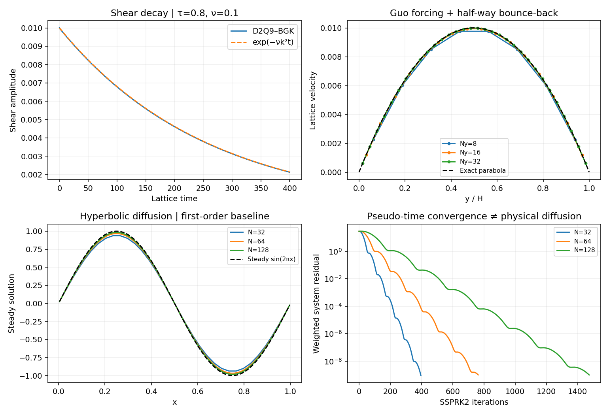

# Nishikawa's hyperbolic diffusion: iterate a first-order system

[Hiroaki Nishikawa (2007)](https://doi.org/10.1016/j.jcp.2007.07.029)
introduces the first-order hyperbolic-system approach to steady diffusion,
including second-order residual-distribution schemes. The
[2010 extension](https://doi.org/10.1016/j.jcp.2009.10.040) unifies advection
and diffusion. The date is the journal publication year, not the DOI's year.

**Implemented here:** a periodic 1D, first-order upwind finite-volume baseline
with SSPRK2. It demonstrates equivalent steady equations; it does not implement
the original paper's second-order multidimensional RD constructions.

## Evolve the solution and its gradient

For the steady problem −νu_xx=f, introduce p and pseudo-time τ:

\[
\partial_\tau u-\nu\partial_x p=f,\qquad
\partial_\tau p-\frac1{T_r}\partial_x u=-\frac p{T_r}.
\]

At convergence, p=u_x, recovering the original steady diffusion equation.
The homogeneous flux Jacobian has eigenvalues

\[
\lambda_\pm=\pm\sqrt{\nu/T_r}.
\]

The relaxation time T_r is a numerical parameter controlling pseudo-time
propagation and damping. It is not the physical diffusivity. A hyperbolic
Courant restriction scales with h for fixed T_r; an explicit source treatment
also has a relaxation restriction. The demonstration therefore uses

\[
\Delta\tau=\frac{C}{a/h+1/T_r},\qquad
 a=\sqrt{\nu/T_r},\quad C\leq\frac12.
\]

A physical heat equation is not recovered at every finite pseudo-time.
Replacing the heat gallery's physical-time curve by this iteration history
would change the problem. Time-accurate extensions require additional analysis.

## Residual convergence and discretization error

The manufactured steady reference is sin(2πx), with zero mean on the periodic
unit interval and forcing ν(2π)²sin(2πx). The initial mean fixes the constant
null mode. Both equation residuals are measured; the gradient residual is
scaled by 2π in the combined RMS diagnostic. A small residual does not eliminate
the first-order upwind spatial error. N=32,64,128 checks that error separately.
[The manifest](figures/solver-foundations.json) records steps and pseudo-time
sizes, without a matched-cost speedup claim.

Compare [Thomas and multigrid](elliptic.md), [sparse preconditioning](sparse-nonlinear.md),
and the [physical diffusion gallery](equation-gallery.md). Anisotropic
diffusion, high-order face reconstruction, viscous Navier–Stokes coupling and
the complete RD formulation are future extensions. Publisher records and
abstracts were checked; full original-paper reproductions are not claimed.
