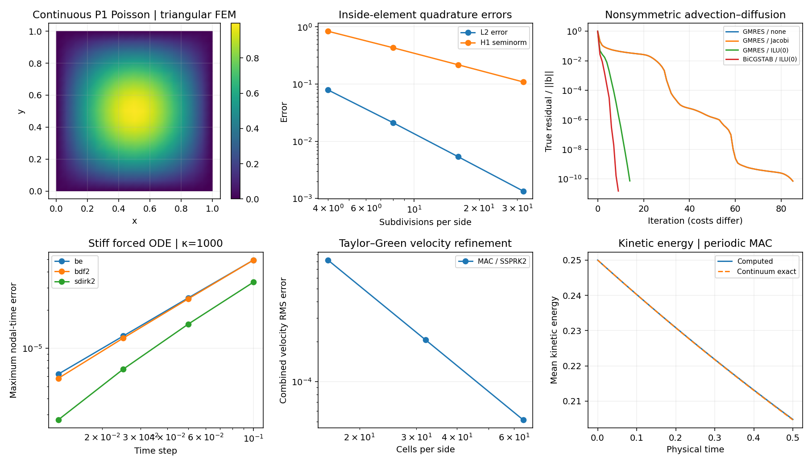

# Incompressible flow: project with compatible discrete operators

**Implemented:** unit-density periodic 2D Navier–Stokes on a MAC grid, centered
convection and viscosity, projected SSPRK2, and discrete-FFT Poisson inversion.

## 1968: the projection branch

[Chorin (1968)](https://doi.org/10.1090/S0025-5718-1968-0242392-2)
is the original projection reference. Our periodic RK model illustrates the
principle; it does not reproduce his boundary treatments or original time step.

Velocity components live on different faces; pressure lives at cell centers.
Choose divergence D and gradient G so that D=−Gᵀ under the periodic grid
inner product. Then

\[
DG\phi=D\boldsymbol u^*,\qquad
\boldsymbol u=\boldsymbol u^*-G\phi,\qquad D\boldsymbol u=0.
\]

The FFT must invert the symbol of **DG**, not continuum −|k|²:

\[
\lambda_h=-\frac4{h^2}
\left[\sin^2(k_xh/2)+\sin^2(k_yh/2)\right].
\]

The pressure constant is undetermined. Set its mean to zero; subtract the mean
from the Poisson source for periodic compatibility. Tests check the adjoint
identity, projection idempotence, energy contraction and divergence removal.

## Taylor–Green verification

On [0,2π)² with viscosity ν, use

\[
u=\sin x\cos y\,e^{-2\nu t},\qquad
v=-\cos x\sin y\,e^{-2\nu t}.
\]

The velocity error refines at second order for N=16,32,64 at T=0.5, ν=0.1.
Mean kinetic energy is e^(−4νt)/4. Stage projection multipliers are not
silently labeled physical pressure; a final pressure estimate is reconstructed
from the momentum RHS, without a claimed pressure-order verification.

[Reproducible measurements](figures/solver-foundations.json) include maximum
absolute discrete divergence. The explicit step retains both advective and
viscous restrictions. No-slip cavity boundaries, SIMPLE/PISO, cylinder wakes,
mixed FEM, turbulence models and experimental validation are not implemented
by this periodic test. Compare the separate low-Mach [LBM model](lattice-boltzmann.md).

The [Arakawa A/B/C comparison](geophysical-grids.md) places this MAC
arrangement in a geophysical context. Matching face locations does not
automatically supply a Coriolis or potential-vorticity algorithm.
