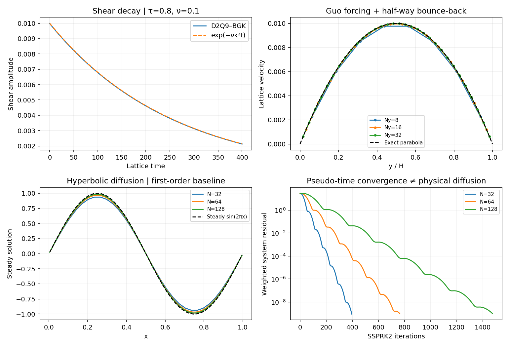

# Lattice Boltzmann: collide, stream, recover fluid motion

**Implemented:** low-Mach, isothermal D2Q9–BGK, Guo body forcing, periodic
boundaries and stationary half-way bounce-back walls. Lattice units use
Δx=Δt=ρ_ref=1, c_s²=1/3.

## 1954 → 1992 → 2002

The relaxation model of [Bhatnagar–Gross–Krook (1954)](https://doi.org/10.1103/PhysRev.94.511)
precedes lattice BGK. [Qian–d'Humières–Lallemand (1992)](https://doi.org/10.1209/0295-5075/17/6/001)
is the lattice-BGK reference. [Guo–Zheng–Shi (2002)](https://doi.org/10.1103/PhysRevE.65.046308)
supplies the force discretization used here. These are distinct developments.

D2Q9 has one resting population, four axial directions and four diagonals.
Weights are 4/9, 1/9 and 1/36 for those groups. The equilibrium is

\[
f_q^{eq}=w_q\rho\left[1+3\boldsymbol c_q\cdot\boldsymbol u
+\frac92(\boldsymbol c_q\cdot\boldsymbol u)^2
-\frac32|\boldsymbol u|^2\right].
\]

Collision relaxes populations, then streaming shifts each by its integer
lattice velocity:

\[
f_q(\boldsymbol x+\boldsymbol c_q,t+1)
=f_q(\boldsymbol x,t)-\frac{f_q-f_q^{eq}}{\tau}+S_q.
\]

For a force density F, Guo forcing uses

\[
S_q=w_q\left(1-\frac1{2\tau}\right)
\left[3(\boldsymbol c_q-\boldsymbol u)
+9(\boldsymbol c_q\cdot\boldsymbol u)\boldsymbol c_q\right]\cdot\boldsymbol F,
\quad
\rho\boldsymbol u=\sum_q f_q\boldsymbol c_q+\frac{\boldsymbol F}{2}.
\]

Density is the population sum, pressure is c_s²ρ, and viscosity is
ν=c_s²(τ−1/2). The [Chapman–Enskog derivation](chapman-enskog.md)
explains the discrete-time half-step correction. τ>1/2 makes this viscosity
positive; it is not a universal nonlinear stability certificate.

## Two independent tests

A transverse periodic shear wave decays as exp(−νk²t), allowing an independent
viscosity measurement. Force-driven Poiseuille flow has exact profile
u_x=F_x y(H−y)/(2ρ_refν). The walls sit half a lattice spacing beyond the
outer fluid nodes, not at those node centers. Fixed τ=0.8, peak velocity 0.01,
and Ny=8,16,32 test wall placement and refinement. Startup runs for twelve
slowest viscous decay times; finite-time and spatial errors remain distinct.

[The data manifest](figures/solver-foundations.json) records channel errors,
Mach numbers, force settings and step counts. Unit tests also verify periodic
mass/momentum conservation and equilibrium moments. BGK is a single-relaxation
baseline: MRT/TRT, entropic and cumulant collisions, thermal/compressible LBM,
moving walls and multiphase models remain extensions. [Projection flow](incompressible.md)
solves a different discrete system and provides another route to incompressibility.
