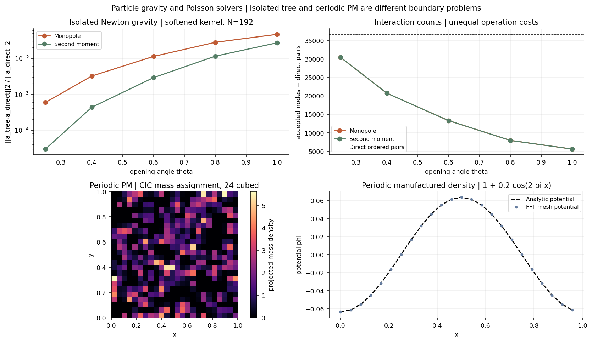

# Particle gravity: PM, P³M, Tree, multipoles, and multigrid

Poisson solvers and particle force algorithms answer related questions with different representations. Begin by fixing the Green function, boundary conditions, mass assignment, softening, and force operator. A periodic PM field and an isolated direct-sum field solve different problems, so their raw difference is not a force-accuracy measurement.



## Particle–mesh: mass to potential to force

In a three-dimensional periodic cube,

\[
\nabla^2\phi=4\pi G(\rho-\overline\rho),\qquad
\widehat\phi(\boldsymbol k)=-\frac{4\pi G}{|\boldsymbol k|^2}\widehat\rho(\boldsymbol k)
\quad(\boldsymbol k\ne0),\qquad \widehat\phi(0)=0.
\]

Subtracting the mean supplies the periodic compatibility condition; setting the potential’s zero mode fixes its gauge. This choice differs from an isolated sheet, whose horizontal mean produces a real vertical force.

PM deposits particle masses onto a grid, solves the mesh Poisson equation, differentiates the potential, and interpolates acceleration back to particles. The example uses cloud-in-cell (CIC) weights on eight neighboring mesh nodes in 3D, a continuum Fourier Laplacian symbol, and spectral force derivatives. An even-grid derivative sets its unpaired Nyquist mode to zero. Matched CIC deposition/interpolation and an odd force operator yield zero total internal force to roundoff in the tested periodic example.

Assignment and interpolation smooth the force. The mesh Green function, discrete derivative, aliasing, grid anisotropy, and any deconvolution all influence the effective particle interaction. Accurate solution of a manufactured mesh mode does not establish accurate close-pair forces.

## P³M: correct the near field without counting it twice

Particle–particle/particle–mesh adds a short-range correction to the mesh force:

\[
\boldsymbol a_i=\boldsymbol a_i^{\rm PM}
+\sum_{j\in\mathcal N_i}\left(\boldsymbol a_{ij}^{\rm target}
-\boldsymbol a_{ij}^{\rm mesh,near}\right).
\]

The subtracted term must correspond to the chosen PM assignment and force operator, or to a consistently designed force split. Adding an unmodified Newtonian pair force to an already complete PM force counts part of the interaction twice. Neighbor lists and clustering determine short-range work. See [Hockney’s original P³M code description](https://www.ccp5.ac.uk/wp-content/uploads/2023/03/CCP5_Newsletter_1981_06_01.pdf).

A production P³M solver, matching correction table, and adaptive refinements are **not implemented** here.

## Barnes–Hut Tree: open the nearby cells

[Barnes and Hut (1986)](https://doi.org/10.1038/324446a0) organize particles into an octree. A distant cell is approximated by its mass distribution moments; nearby cells are opened recursively. Our geometric acceptance test is s/d < theta, with cell side s and distance d to its center of mass. A node containing the target is always opened, and direct leaves exclude self-interaction.

The implemented isolated reference uses G = 1 and Plummer softening:

\[
\boldsymbol a_i=-\sum_{j\ne i}m_j
\frac{\boldsymbol x_i-\boldsymbol x_j}
{(|\boldsymbol x_i-\boldsymbol x_j|^2+\epsilon^2)^{3/2}}.
\]

The Tree and direct sum use identical particles, masses, and epsilon. Smaller theta usually trades more interactions for lower error, but individual-particle errors need not decrease monotonically. The familiar O(N log N) description is a typical algorithmic scaling under suitable distributions, not a timing result or worst-case guarantee for this Python example.

## Multipole expansion: monopole and second moments

Let R point from a cell’s center of mass to the target, delta_a be source offsets, M be total mass, and S = sum m_a delta_a delta_a^T. The center-of-mass dipole vanishes. With s² = R²+epsilon², a Taylor expansion of the same softened kernel gives

\[
\phi(\boldsymbol R)\approx-G\left[
\frac{M}{s}+\frac{3\boldsymbol R^T S\boldsymbol R}{2s^5}
-\frac{\operatorname{tr}S}{2s^3}\right].
\]

The code differentiates this potential analytically. It retains the full second moment, including its trace; silently substituting an unsoftened traceless quadrupole formula would change the approximation. The gallery compares monopole and second-moment errors against the same direct force sum.

A fast multipole method also forms and translates local expansions, reusing cell-to-cell interactions. It is more than adding a quadrupole to Barnes–Hut. [Greengard and Rokhlin (1987)](https://doi.org/10.1016/0021-9991(87)90140-9) are the original FMM reading reference; FMM translations are not implemented here.

## TreePM: a different near-field evaluator

TreePM combines a mesh long-range field with a short-range Tree field. A representative Gaussian potential split has

\[
\widehat\phi_{\rm long}=\widehat\phi\,e^{-k^2r_s^2},\qquad
\phi_{\rm short}(r)=-\frac{Gm}{r}\operatorname{erfc}\left(\frac{r}{2r_s}\right).
\]

The short-range force is the derivative of this potential, not merely Newton’s force times erfc. Cutoffs, periodicity, and softening must match the split. [Springel’s GADGET-2 paper](https://arxiv.org/abs/astro-ph/0505010) provides a primary example. The two independent PM and Tree examples here do **not** constitute an implemented TreePM solver.

## Where multigrid belongs

Multigrid solves a discretized elliptic equation rather than directly summing particle pairs. A smoother reduces oscillatory error; restriction, a coarse solve, prolongation, and correction address smoother error components. It can replace the grid Poisson solve inside a particle–mesh pipeline, provided its operator, boundary treatment, and particle coupling are specified.

The [existing multigrid implementation](elliptic.md) solves a **2D five-point negative-Laplacian problem with zero Dirichlet boundaries**. It is not yet the isolated 3D particle-gravity solver. Boundary values for an isolated finite mesh may be supplied by multipoles or another open-boundary construction; setting phi = 0 at a nearby box face generally does not reproduce phi tending to zero at infinity.

## Reproduce the static checks

```bash
python scripts/build_particle_gravity.py
```

This creates the figure and [measurement manifest](figures/particle-gravity.json). The Tree experiment uses 192 equal-mass particles, seed 17, epsilon = 0.03, five opening angles, and both moment orders. Its error is ||a_tree−a_direct||₂ / ||a_direct||₂. Counts of accepted nodes and direct pairs are reported; their operation costs differ, so their sum is not a timing comparison.

The PM test uses a 24³ periodic mesh. A separate density 1+0.2 cos(2 pi x) has potential −0.2 cos(2 pi x)/pi for G = 1. Tests cover CIC mass conservation, periodic wrapping, constant interpolation, self-force, net force, the manufactured Poisson mode, exact Tree opening at theta = 0, and selected force-error refinements. A target-by-target approximate Tree need not preserve pairwise momentum exactly; the manifest records a net-force diagnostic.

Continue with [isolated FFT and slab Green functions](gravity-boundaries.md), and the [symplectic map chapter](symplectic.md) for the additional requirements on force consistency and time integration.
