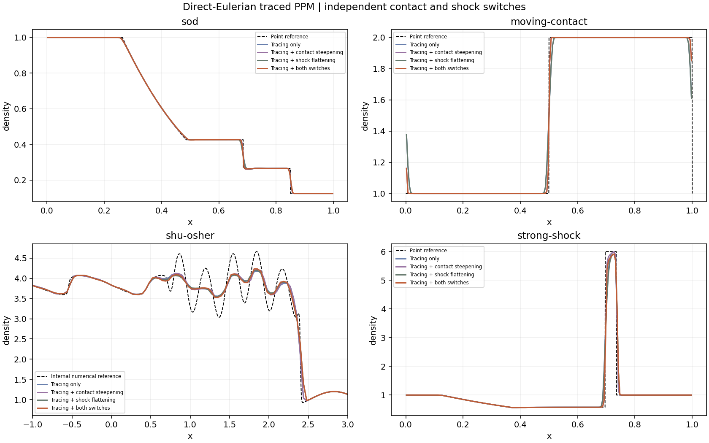
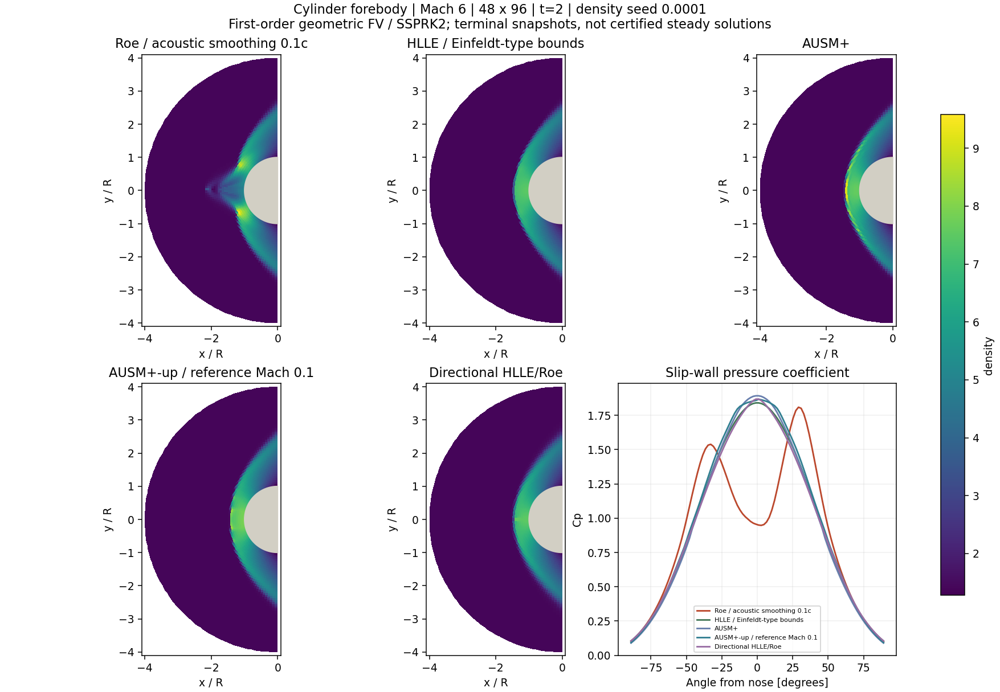

# Traced PPM, AUSM variants and curved bow shocks

[Open the new computed comparison](#/shock-expansion). This stage adds a direct-Eulerian characteristic-traced PPM update, specified AUSM+ and AUSM+-up fluxes, and a circular-cylinder **forebody** diagnostic. The earlier [method-of-lines reconstruction](reconstruction.md) and [planar odd–even experiment](carbuncle.md) retain their original data and scope.

## Direct-Eulerian PPM and independent switches

`numart.ppm_traced` reconstructs primitive density, velocity and pressure from conserved cell means. It uses MC-limited parabolic interpolation, optional density contact steepening, optional shock flattening and componentwise parabolic monotonicity constraints. Mean conserved states are updated by a shared face flux. A primitive profile reconstructed from a conserved mean is a second-order representation; it is not an exact average of primitive variables.

For each primitive profile, with local cell coordinate xi in [0,1],

\[
q(\xi)=q_L+\xi[\Delta q+q_6(1-\xi)],\qquad
\Delta q=q_R-q_L,\qquad q_6=6q_i-3(q_L+q_R).
\]

Average over a fraction sigma of the domain next to either edge:

\[
I_R(\sigma)=q_R-\frac{\sigma}{2}\left[\Delta q-\left(1-\frac{2\sigma}{3}\right)q_6\right],\qquad
I_L(\sigma)=q_L+\frac{\sigma}{2}\left[\Delta q+\left(1-\frac{2\sigma}{3}\right)q_6\right].
\]

The three wave speeds are u−c, u and u+c. For each incoming family, sigma=|lambda| dt/dx. Starting from the fastest incoming wave's domain average, correct the other incoming characteristic components using a primitive eigenbasis frozen at the cell state. These are time-averaged Riemann inputs for **one conservative step**. Applying an additional SSPRK3 wrapper to this predictor would define a different method. The default flux is HLLC and CFL is 0.4.

The construction follows the direct-Eulerian characteristic-domain approach in the inspected [Colella–Woodward author preprint](https://escholarship.org/uc/item/5sr307f1), with the [1984 paper](https://doi.org/10.1016/0021-9991(84)90143-8) as the original publication. The [Cholla author manuscript, Appendix A](https://arxiv.org/abs/1410.4194) is an additional algorithmic cross-check. The implementation is independent: it does not reproduce every production-code option, multidimensional CTU, artificial viscosity, Lagrangian evolution or remap. Some displayed Cholla appendix signs/indices are inconsistent with the described neighboring-cell construction; the explicit formulas below and executable checks define this variant.

## Contact steepening and shock flattening

Steepening changes density edges only. Let D2_i=(rho_(i+1)−2rho_i+rho_(i−1))/6. Require D2_(i−1) D2_(i+1)<0, a relative density jump above 0.01, and a relative pressure jump smaller than 0.1 gamma times the relative density jump. Then

\[
\widetilde\eta_i=-\frac{D^2_{i+1}-D^2_{i-1}}{\rho_{i+1}-\rho_{i-1}},\qquad
\eta_i=\operatorname{clip}\!\left(20(\widetilde\eta_i-0.05),0,1\right).
\]

Blend the density left edge toward rho_(i−1)+delta_rho_(i−1)/2 and the right edge toward rho_(i+1)−delta_rho_(i+1)/2, using MC slopes in those neighboring cells. This suppresses contact spreading but can sharpen an under-resolved smooth density transition. It should not be treated as a universal accuracy improvement.

Flattening uses S_i=(p_(i+1)−p_(i−1))/(p_(i+2)−p_(i−2)). The preliminary coefficient is clip(10(S_i−0.75),0,1), enabled only for a relative pressure jump at least 1/3 and a compressive velocity difference. Take the larger coefficient of the cell and its lower-pressure neighbor. Every primitive edge is blended toward its cell value before monotonicity enforcement. A coefficient of 1 removes the spatial variation; 0 leaves it unchanged.

Reconstructed inputs that violate density/pressure thresholds of 1e−12 use a common conservative affine scaling about the unchanged cell mean. Invalid completed updates retry with half the time step, up to 14 attempts. These are safeguards, **not a fully discrete positivity proof**. Failure preserves the last accepted state and actual time. No state clipping, hidden flux substitution or false final-time label is used.

The four switch combinations use identical flux, nominal CFL and update algorithm. At N=200 for one moving-contact crossing, steepening reduces density error while pressure and velocity stay constant to roundoff. Smooth entropy-wave grids N=32,64,128 show approximately second-order convergence of the complete traced method; no third- or fourth-order time-accuracy claim is made.

## AUSM+ and AUSM+-up with stated controls

The older arithmetic-sound-speed AUSM baseline stays separate. The new fluxes use fourth-degree Mach and fifth-degree pressure splitting. For |M|<1,

\[
\mathcal M_4^\pm(M)=\pm\left[\frac{(M\pm1)^2}{4}+\frac{(M^2-1)^2}{8}\right],\qquad
\mathcal P_5^\pm(M)=\frac{(M\pm1)^2(2\mp M)}4\pm\alpha M(M^2-1)^2.
\]

Outside this interval, use signed upwind Mach and pressure fractions. Both variants use the directional critical-enthalpy sound speed employed in the 2006 formulation:

\[
a_{*,k}^2=\frac{2(\gamma-1)}{\gamma+1}H_k,\qquad
a_f=\min\left(\frac{a_{*,L}^2}{\max(a_{*,L},u_L)},
\frac{a_{*,R}^2}{\max(a_{*,R},-u_R)}\right).
\]

The displayed **AUSM+** has alpha=3/16 and no pressure/velocity diffusion terms. It is the specified basic member of this formulation, not a claim to reproduce every 1996 interface-sound-speed option. **AUSM+-up** uses Kp=0.25, Ku=0.75, sigma=1 and a reference Mach cutoff of 0.1:

\[
\overline M^2=\frac{M_L^2+M_R^2}{2},\quad
M_0=\sqrt{\min(1,\max(\overline M^2,M_{\rm ref}^2))},\quad
f_a=M_0(2-M_0),\quad\alpha=\frac{3}{16}(5f_a^2-4).
\]

Add the pressure diffusion term to the interface Mach number and velocity diffusion to its pressure:

\[
M_p=-\frac{K_p}{f_a}\max(1-\overline M^2,0)
\frac{p_R-p_L}{\overline\rho a_f^2},\qquad
p_u=-K_u f_a\mathcal P_5^+(M_L)\mathcal P_5^-(M_R)
(\rho_L+\rho_R)a_f(u_R-u_L).
\]

Upwind density, velocity and total enthalpy using the resulting mass-flux sign. Add interface pressure to normal momentum. Tests check uniform flow, both supersonic directions, contacts, stationary normal shocks, sonic branch limits, reversal conservation and rotational covariance.

[Liou (1996)](https://doi.org/10.1006/jcph.1996.0256) and [Liou (2006)](https://doi.org/10.1016/j.jcp.2005.09.020) are the original references. The sound-speed and diffusion definitions were cross-checked against the [official SU2 implementation](https://github.com/su2code/SU2/blob/master/SU2_CFD/src/numerics/flow/convection/ausm_slau.cpp). Our Python code is independent and supplies no implicit Jacobian or time preconditioning.

The low-Mach graph varies the cutoff across 0.01,0.1,1 for a tiny fixed pressure jump. It is a **flux sensitivity**, not verification of a low-Mach vortex, boundary layer or asymptotic-preserving PDE scheme. A cutoff and the time-step restriction remain part of the numerical method.

## Matched one-dimensional problems and a recorded failure

All new 1D runs use traced PPM with CFL 0.4. The flux comparison fixes contact steepening off and shock flattening on. It switches HLLC, old AUSM, AUSM+ and AUSM+-up. These are independent adaptive-CFL runs, not matched-step or matched-cost timings.

The cases are Sod N=200, moving contact N=200, Shu–Osher N=240, and a strong pressure jump N=200. The first three retain the setups in [the earlier comparison](reconstruction.md). The last uses primitive left (1,0,1000), right (1,0,0.01), gamma=1.4, a jump at x=0.5, extrapolated ends and t=0.01 on [0,1]. Its waves remain away from the boundaries at that time.

Sod and strong-jump density errors use front-split 24/48-point quadrature of conserved Riemann states. The moving-contact reference returns to its initial cell means after one crossing. Shu–Osher retains the earlier internal characteristic FD WENO-Z N=960 reference; it is numerical, not exact, and no exact error is reported. Point-reference curves and primitive variables of conserved means have distinct conventions.

The stated strong-jump **AUSM+ configuration exhausts its admissibility retries before t=0.01**. Its table reports failure and the actual stopping time; it is excluded from the final-time curves. The download retains the last accepted conserved state and reason. This demonstrates that the implemented flux, reconstruction safeguards and nominal CFL together do not establish update positivity. Other completed runs can also require retries; inspect their counts.

## A conservative mesh around the cylinder nose

The 2D experiment covers only the upstream half of a unit circular cylinder: r in [1,4], theta in [pi/2,3pi/2], with flow in the positive x direction. Straight-sided annular quadrilaterals conform to the polygonal approximation of the body. Two grids have 24×48 and 48×96 cells. Radius and angle are uniformly spaced, but physical cells are not squares.

Cartesian conserved variables use face-normal numerical fluxes with shared face lengths. Polygon areas, radial chord normals and angular-face normals obey geometric closure to roundoff. This avoids curvilinear momentum source terms. Tests check free-stream preservation when the wall is disabled, reflection of wall-normal momentum, zero wall mass/energy flux and the integrated flux budget.

Use rho_inf=1.4, p_inf=1, u_inf=6, v_inf=0, gamma=1.4, giving sound speed 1 and Mach 6. The inner wall is inviscid slip; the outer boundary is fixed free stream and both angular exits extrapolate. Initial conditions are free stream, optionally modified by

\[
\rho(r,\theta)=\rho_\infty\left[1+\epsilon
e^{-((r-1.5)/0.3)^2}\sin\bigl(12(\theta-\pi)\bigr)\right],\qquad
\epsilon\in\{0,10^{-4}\}.
\]

Velocity and pressure are unchanged initially. The perturbation is a density mode, not a displaced mesh or shock front. The angular wavelength is held fixed under refinement. Both controls and seeded runs use first-order geometric FV, SSPRK2, CFL 0.4 and terminal time 2. CFL uses the sum of all face spectral radii; it is not numerically identical to the 1D CFL rule. There are 20 forebody runs: five fluxes, two grids and two seed amplitudes.

## Directional HLLE and Roe composition

For a face normal n, choose n1 along the velocity jump and n2 perpendicular to it; orient their signs to make alpha_k=n dot n_k nonnegative. If the velocity jump is below 1e−10 in these nondimensional units, n1 is face-tangential and n2 face-normal. Define

\[
\widehat{\boldsymbol F}(\boldsymbol n)=
\alpha_1\widehat{\boldsymbol F}_{\rm HLLE}(\boldsymbol n_1)+
\alpha_2\widehat{\boldsymbol F}_{\rm Roe}(\boldsymbol n_2),\qquad
\boldsymbol n=\alpha_1\boldsymbol n_1+\alpha_2\boldsymbol n_2.
\]

The same left/right physical states are rotated into each local frame. Rotate momentum fluxes back to Cartesian coordinates before combining. A normal velocity jump selects HLLE; a purely tangential shear selects Roe in the face-normal direction. Constant states remain consistent because physical Euler flux is linear in the normal vector. The construction also passes flux-reversal conservation and rotation tests.

This is a specified **rotated-hybrid experiment**, inspired by [Nishikawa and Kitamura (2008)](https://doi.org/10.1016/j.jcp.2007.11.003). It is not the earlier pressure-sensor Roe/HLLE blend, and does not claim an optimized reproduction of the publication's Rotated-RHLL dissipation formula. The tiny-jump fallback and dimensional tolerance are explicit implementation choices.

## What the forebody results establish

The five fluxes are acoustically smoothed Roe, Einfeldt-type HLLE, AUSM+, AUSM+-up and directional HLLE/Roe. Each image shares one color range across its five field panels. The slip-wall pressure coefficient uses the actual wall-normal momentum flux; the two cells nearest the nose define the reported nose pressure.

The normal-shock jump followed by isentropic deceleration gives the inviscid centerline stagnation-pressure reference p0,2=46.8152057161. It is a scalar streamline reference, **not an exact bow-shock field**. The boundary layer and wake are absent. The nose pressure, reflection defect, remaining normalized update rate, positivity and integrated conservation residual are all saved.

On the fine seeded grid, Roe develops a large density reflection defect and its nose pressure falls to about 25.0. The fine HLLE nose pressure is about 47.38; the corresponding coarse value is about 48.81. The directional method and AUSM variants have different perturbation and grid responses. In particular, the directional method can amplify roundoff in its unperturbed control: a symmetric-looking initial state is not an exact discrete symmetry guarantee for that nonlinear direction selection. Inspect both controls and histories rather than selecting a single attractive image.

These are **terminal snapshots of an evolving calculation**. Nonzero update rates and two grid levels do not certify a converged steady solution, an asymptotic convergence order, or universal carbuncle freedom. Longer-time and time-step studies, other Mach numbers, rotated grids, external-code comparisons and further rotated-hybrid variants remain verification work. Full-cylinder viscous drag, lift, shedding and Strouhal validation are a separate task.

## Reproduction and saved data

Run `MPLCONFIGDIR=.mplconfig python scripts/build_shock_expansion.py`. The builder caches forebody runs only when the numerical source hashes and full configuration match. [Download controls, diagnostics and source hashes](figures/shock-expansion/shock-expansion.json) and [conserved states and mesh vertices/areas](figures/shock-expansion/fields.npz). Failed 1D entries include actual times and last accepted states; they must not be compared as if they reached the requested final time. All PNGs and the compressed arrays have hashes in the manifest.

The independent checks cover characteristic-domain integrals, switch selectivity, periodic conserved sums, pressure/velocity contact equilibrium, smooth refinement, AUSM branch identities and normal shocks, rotated-flux consistency/covariance, mesh closure and wall/global flux budgets. Passing these checks does not remove the flow-specific limits above.
