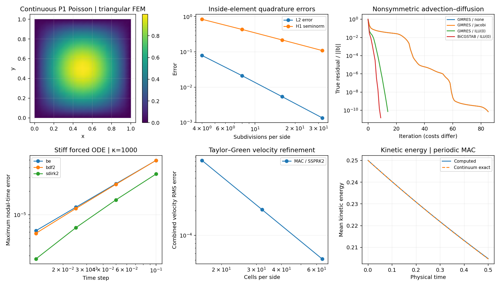

# Sparse and nonlinear systems: measure the actual residual

**Implemented:** COO-to-CSR assembly, restarted GMRES, BiCGSTAB, Jacobi and
unpivoted ILU(0), and Armijo-damped Newton with dense or Krylov inner solves.
These are small, inspectable real-arithmetic examples.

## 1986–1992: nonsymmetric Krylov methods

[Saad–Schultz (1986)](https://doi.org/10.1137/0907058) introduces GMRES;
[van der Vorst (1992)](https://doi.org/10.1137/0913035) introduces BiCGSTAB.
The implemented GMRES uses Arnoldi reorthogonalization and small Hessenberg
least squares, restarting after a specified number of inner iterations.
BiCGSTAB has explicit breakdown reporting; it need not have monotone residuals.

Both implementations apply a **fixed right preconditioner**:

\[
A M^{-1} z=b,\qquad x=M^{-1}z,
\qquad \|b-Ax\|_2\leq\max(\mathrm{atol},\mathrm{rtol}\|b\|_2).
\]

The stopping history recomputes the true residual. Jacobi uses diagonal
scaling. ILU(0) retains the supplied nonzero structure, with no fill, pivoting
or reordering; tiny pivots raise an explicit failure. This is not a robust
replacement for a production sparse factorization.

## Newton and conditioning

Newton solves J(x)δ=−F(x), then chooses a backtracked step length with an
Armijo residual decrease. The Newton–Krylov demonstration assembles J and
uses GMRES; it is **not matrix free**. Bratu's equation is checked against an
analytic solution at two spatial resolutions, including inner-solve failures.

A small residual is not automatically a small solution error:

\[
\frac{\|x-\hat x\|}{\|x\|}
\leq \kappa(A)\frac{\|b-A\hat x\|}{\|b\|}.
\]

Condition number, eigenvalue distribution and nonnormality describe different
features. A smaller condition number alone does not rank restarted GMRES.
CG still requires an SPD operator and suitable SPD preconditioning; generic
ILU(0) is not asserted to satisfy that requirement.

The nonsymmetric example is first-order upwind advection plus centered diffusion
with zero Dirichlet data. Iteration counts have different per-iteration costs;
the figure makes no wall-clock ranking. See the [data and source hashes](figures/solver-foundations.json),
[FEM assembly](fem.md), and [implicit ODE stages](stiff-integration.md).
