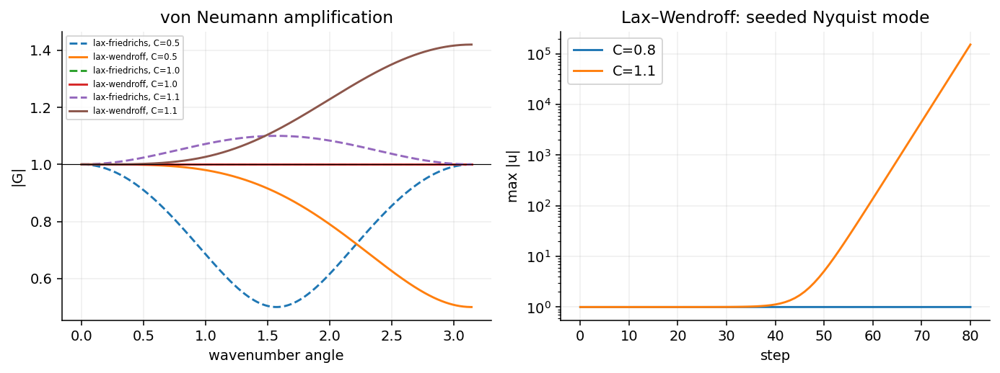

# 差分、CFL、von Neumann、Lax

## 空間と時間を別々に選ぶ

空間微分の前進・後退・中心差分は、それぞれ

\[
D_+u_j=\frac{u_{j+1}-u_j}{h},\qquad
D_-u_j=\frac{u_j-u_{j-1}}h,\qquad
D_0u_j=\frac{u_{j+1}-u_{j-1}}{2h}.
\]

滑らかな関数では前二者は 1 次、中心差分は 2 次です。
`numart.advection.finite_difference` で比較できます。
風上差分は線形移流 `u_t+a u_x=0` の情報伝播方向で選び、`a>0` なら後退、`a<0` なら前進です。
前進差分と風上差分は同義ではありません。

時間の前進 Euler は `u^{n+1}=u^n+Δt L_h u^n`、後退 Euler は
`u^{n+1}=u^n+Δt L_h u^{n+1}`。後者は連立方程式を解きます。
空間に後退差分を使うことだけでは陰解法になりません。

## CFL：必要な情報に到達できるか

周期・定係数の移流と最近傍の陽的ステンシルなら、依存領域から `|a|Δt/h ≤ 1` が必要になります。
他のステンシル、Runge–Kutta、DG、多次元で定数は変わり、拡散では `Δt=O(h²)` の制限が現れます。
CFL 条件は一般に安定性の十分条件ではありません。
[Courant–Friedrichs–Lewy (1928)](https://doi.org/10.1007/BF01448839)。

反例は前進時間・中心空間 (FTCS) の純移流です。
Fourier モード `u_j^n=G^n e^{ijθ}` を代入すると

\[
G=1-i C\sin θ,\quad |G|^2=1+C^2\sin^2 θ,
\qquad C=a\Delta t/h.
\]

`|C|<1` でも増幅するモードがあり、通常の固定 CFL の格子細分化では不安定です。

## Lax–Friedrichs と Lax–Wendroff

Lax–Friedrichs は

\[
u_j^{n+1}=\tfrac12(u_{j+1}^n+u_{j-1}^n)
-\tfrac C2(u_{j+1}^n-u_{j-1}^n),\qquad
G=\cos θ-iC\sin θ.
\]

`|G|²=1-(1-C²)sin²θ` なので周期線形移流では `|C|≤1` が安定条件です。
ここでの古典的 LF は数値粘性係数 `h/Δt` を持ちます。
局所最大波速を係数に使う Rusanov 流束と、WENO の大域 LF 流束分離を同一の離散化として扱いません。
[Lax (1954)](https://doi.org/10.1002/cpa.3160070112)。

Lax–Wendroff は

\[
u_j^{n+1}=u_j^n-\tfrac C2(u_{j+1}^n-u_{j-1}^n)
+\tfrac{C^2}{2}(u_{j+1}^n-2u_j^n+u_{j-1}^n),
\]
\[
G=1-iC\sin θ+C^2(\cos θ-1),\quad
|G|^2=1-4C^2(1-C^2)\sin^4(θ/2).
\]

こちらもこの問題では `|C|≤1`。2 次精度でも、不連続付近の振動を抑える性質は別です。
[Lax–Wendroff (1960)](https://doi.org/10.1002/cpa.3160130205)。

`amplification` と `difference_step` は解析式と実際のモードの増幅が一致するか自動検証します。
`gallery` は小さな Nyquist 誤差を種に、`C=0.8` と `C=1.1` を比較します。

## Lax–Richtmyer の同値定理

適切な Banach 空間で適切に設定された**線形初期値問題**と、それに整合的な**線形差分近似**を考えます。
安定性を、固定した有限時間区間における離散発展作用素の一様有界性として定義すると、
安定性と収束性は同値です。
[Lax–Richtmyer (1956), 原論文](https://math.berkeley.edu/~wilken/228B.S07/LaxRichtmyer.pdf)。

誤差を `e^{n+1}=S_h e^n+Δt τ^n` と書き、`||S_h^m||≤M_T` なら
`||e^n||≤M_T||e^0||+M_T T max||τ^k||`。
整合性から右辺の打切り誤差項が消え、収束する、というのが一方向の基本構造です。
逆方向には一様有界性の議論が必要です。

この定理をそのまま非線形 Euler、WENO、衝撃波、任意の境界処理の保証に使うことはできません。
Fourier の `|G|≤1` 判定も、ここでは周期・定係数のスカラー問題を対象にしています。
境界、変係数、非正規な行列、多段法では追加の解析が必要です。

## 初版の時間刻み

Euler／barotropic は `Δt=C h/max(|u|+c)`、既定 C=0.3。
DG は `Δt=C h/((2p+1)|a|)`、既定 C=0.2。
2D MHD は `Δt=C/[max(s_x)/h+max(s_y)/h]`、既定 C=0.3。
これらは選定例で確認した保守的な設定であり、あらゆる初期値に対する厳密な非線形安定限界ではありません。
