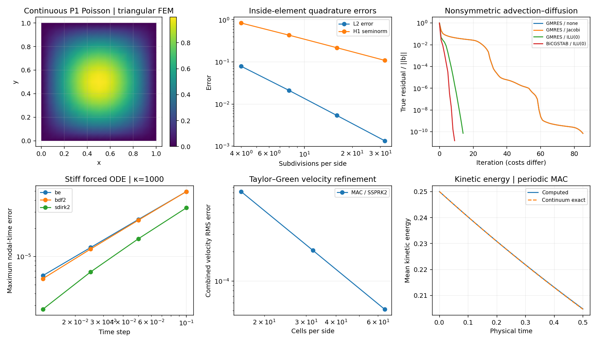

# Stiff integration: solve the stage, control the time error

**Implemented:** backward Euler, constant-step BDF2 with backward-Euler startup,
two-stage SDIRK2, first-order IMEX Euler, and adaptive SDIRK2 by step doubling.
All nonlinear stages use damped Newton and report failure explicitly.

## Implicit stages and stability

Backward Euler solves y_new−y_old−h f(t_new,y_new)=0. BDF2 solves

\[
\frac{3y_{n+1}-4y_n+y_{n-1}}{2h}=f(t_{n+1},y_{n+1}).
\]

[Alexander (1977)](https://doi.org/10.1137/0714068) is the source for the
L-stable, two-stage, second-order singly diagonally implicit family used here:

\[
\gamma=1-1/\sqrt2,\qquad
A=\begin{pmatrix}\gamma&0\\1-\gamma&\gamma\end{pmatrix},
\quad b=(1-\gamma,\gamma),\quad c=(\gamma,1).
\]

Each diagonal stage is a separate nonlinear solve. An implicit method can
permit steps beyond an explicit stability limit, while accuracy still limits
useful step size. A converged Newton residual measures the stage equation,
not the temporal discretization error.

## Adaptive and split steps

The adaptive implementation compares one full SDIRK2 step with two half steps.
The local error estimate is (y_half−y_full)/3, scaled by
atol+rtol max(|y_old|,|y_half|). It accepts the two-half-step value, without
Richardson extrapolation, and adjusts h with exponent −1/3. Rejected trials
and accepted steps are counted; reaching a trial limit raises an error.

IMEX Euler evaluates one part explicitly and the other implicitly. This
minimal first-order split is not the higher-order IMEX RK constructions of
[Ascher–Ruuth–Spiteri (1997)](https://doi.org/10.1016/S0168-9274(97)00056-1).
The explicit part retains its own stability restriction. Variable-step BDF,
embedded DIRK pairs and operator splitting remain extensions.

The stiff test y′=−1000(y−cos t)−sin t has exact solution cos t when y(0)=1.
[The manifest](figures/solver-foundations.json) records maximum errors at actual
integration nodes and adaptive step counts. Separate tests verify order on a
nonlinear, nonautonomous ODE and strong damping of a stiff decay mode.

The coarse stiff-forced refinement is not in a uniform second-order regime.
BDF2 startup and stiff order reduction affect the maximum-over-nodes error;
the nonlinear nonstiff order test checks the formal temporal order separately.

For definitions and comparisons of **A-stability, L-stability and L1/L2/L∞ error norms**,
see the [shared accuracy and stability guide](accuracy-stability.md).
